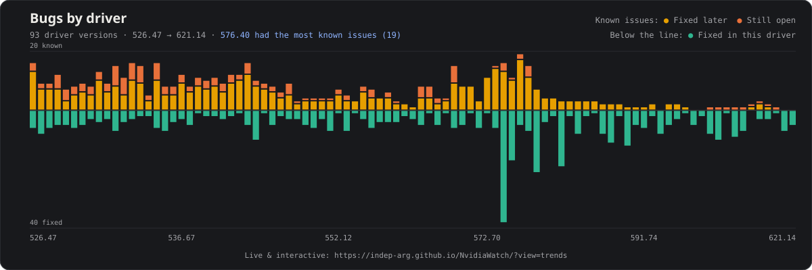

# NvidiaWatch

**Live:** [indep-arg.github.io/NvidiaWatch](https://indep-arg.github.io/NvidiaWatch/)

I built this simple tracker to log bugs found in NVIDIA drivers (Game Ready & Studio) and create a searchable database of known issues, whether they're fixed, pending, or simply forgotten. Yes, sometimes bugs just disappear in the next driver release with no explanation: was it actually fixed? Was it an external issue? Does it still exist? No one knows.

This database can help in several ways. For example, we can analyze which driver branches were hit hardest by bugs and which were the most stable. All data is sourced from official NVIDIA release notes.

## Bug trends



Each bar is one driver. Above the line are the known issues it shipped with: the ones fixed later (in a later driver, or outside the driver by a game patch or an OTA profile update) and the ones still open, with no fix logged yet. Below the line are the bugs that driver fixed.

## What's on the site

The home page shows the newest Game Ready driver with what it fixed and its known issues, plus the newest Studio driver.

From there you can:

- Search all drivers by game, driver version, known issue or NVIDIA bug ID, and filter by status or by channel (Game Ready, Studio).
- Open a driver to see everything NVIDIA listed for it: its fixes, its known issues, and the open issues it inherited from earlier drivers. Each driver page also links to its release notes and feedback thread.
- Open a bug ID to follow its history: which driver listed it first, which ones repeated it, and which one finally fixed it.
- Compare drivers in the Trends charts, including a timeline by release date with the RTX 40 and RTX 50 launch periods marked.

The [Methodology](https://indep-arg.github.io/NvidiaWatch/?view=about) page explains how bugs are counted and what the data can't show.

## Running it locally

The site is plain HTML, CSS and JavaScript hosted on GitHub Pages. There is no framework and nothing to build, so any static server works:

```
python -m http.server --directory docs
```

Then open http://localhost:8000.

Everything the site serves is in `docs/`. The data is in `docs/drivers.json` (drivers and bugs) and `docs/events.json` (GPU launches for the timeline). `scripts/` has the data validator and the script that draws the chart above, and `tests/` covers both scripts and `docs/lib.js`.

To run the checks:

```
python scripts/validate_data.py
python -m unittest discover -s tests
node --test tests/lib.test.js
```

## Contributing

Found a bug in a driver, or know of an issue that's missing? Open an issue or a PR. See [CONTRIBUTING.md](CONTRIBUTING.md) for the data format.

## License

The code is MIT licensed, see [LICENSE](LICENSE). The data in `docs/drivers.json` is licensed under CC BY 4.0, see [LICENSE-DATA.md](LICENSE-DATA.md). Third-party notices are in [THIRD_PARTY_NOTICES.md](THIRD_PARTY_NOTICES.md).

Not affiliated with or endorsed by NVIDIA.
